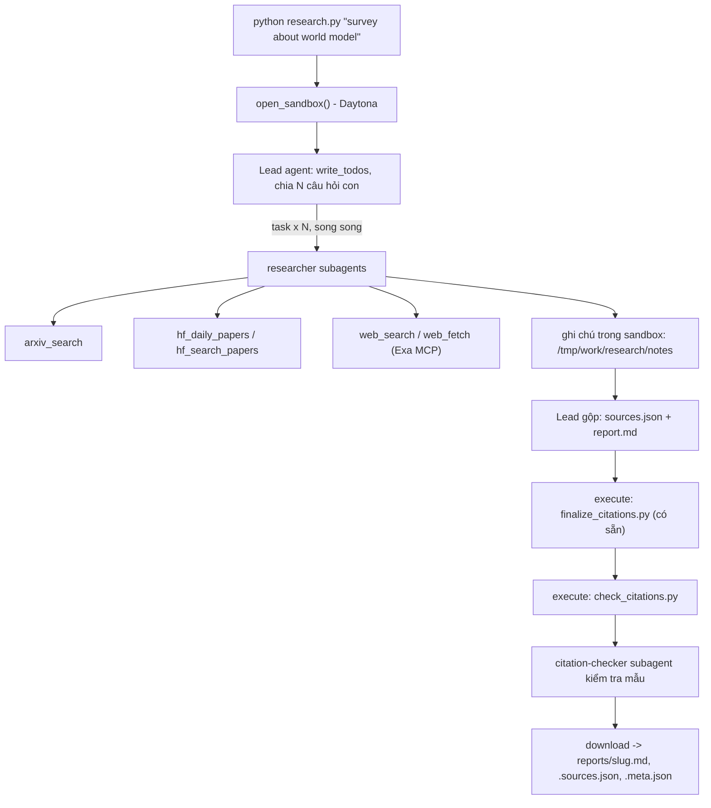

# Deep Research Agent (Deep Agents + Sandbox)

Lab dựng một **hệ thống deep research đa tác tử**: người dùng chỉ cần nhập một chủ đề (ví dụ `survey about world model`), hệ thống tự lập kế hoạch, giao việc cho nhiều subagent, tìm tài liệu trên arXiv, Hugging Face và web, rồi viết một **báo cáo có trích dẫn**.

Hình thức: **bài thực hành cá nhân**. Ngôn ngữ lập trình: Python 3.11 trở lên.

## 1. Mục tiêu học tập

Sau lab, bạn có thể:

1. Dựng agent bằng thư viện Deep Agents (LangChain): công cụ (tool), system prompt, subagent, backend.
2. Dùng **sandbox** (Daytona) làm không gian làm việc và nơi chạy mã cho agent; hiểu vì sao khóa API và công cụ mạng phải nằm ở phía host chứ không nằm trong sandbox.
3. Viết công cụ gọi API ngoài **chịu được giới hạn tốc độ** (retry, backoff, jitter, `Retry-After`).
4. Thiết kế quy trình đa tác tử: lead chia nhỏ câu hỏi, giao cho N researcher chạy song song, tổng hợp và kiểm tra trích dẫn.
5. Tạo báo cáo có thể kiểm chứng: mọi khẳng định có `[n]` trỏ tới một nguồn có thật.

## 2. Hệ thống làm gì



Nguồn dữ liệu:

| Nguồn | Dùng để |
|---|---|
| arXiv API `https://export.arxiv.org/api/query` | Tìm bài theo từ khóa, sắp theo ngày |
| Hugging Face Daily Papers `/api/daily_papers` | Bài đang "trending": upvotes, githubRepo, summary |
| Hugging Face papers search `/api/papers/search?q=` | Tìm bài theo chủ đề |
| Web qua Exa MCP (`web_search_exa`, `web_fetch_exa`) | Blog, survey, trang dự án, nội dung đầy đủ của một URL |

## 3. Cấu trúc thư mục

```
Lab/
├── README.md  GUIDE.md  RUBRIC.md  REPORT_TEMPLATE.md   tài liệu
├── topics.md                 5 chủ đề cần chạy
├── requirements.txt  .env.example  .gitignore
├── model.py                  CÓ SẴN - không sửa: tạo mô hình LLM từ biến môi trường
├── sandbox.py                CÓ SẴN - không sửa: sandbox Daytona (hoặc Docker), upload, download
├── self_check.py             CÓ SẴN - không sửa: tự kiểm tra trước khi nộp (python self_check.py)
├── finalize_citations.py     CÓ SẴN - không sửa: script chạy trong sandbox, tự sinh `## References` và đánh số lại trích dẫn
├── tools.py                  SINH VIÊN CÀI ĐẶT: retry + 5 công cụ nguồn dữ liệu
├── agents.py                 SINH VIÊN CÀI ĐẶT: prompt, subagent, lead agent
├── research.py               SINH VIÊN CÀI ĐẶT: script chính
├── check_citations.py        SINH VIÊN CÀI ĐẶT: kiểm tra trích dẫn, chạy TRONG sandbox
└── reports/                  báo cáo sinh ra (bạn commit vào repo nộp)
```

Mỗi tệp "SINH VIÊN CÀI ĐẶT" là **pseudo-code chạy được** (import được): các hàm có docstring mô tả việc cần làm, các `TODO n` đánh số theo `GUIDE.md`, thân hàm đang `raise NotImplementedError`.

## 4. Cài đặt

```bash
python3 -m venv .venv && source .venv/bin/activate      # Python 3.11+
pip install -r requirements.txt
cp .env.example .env                                     # rồi điền khóa CỦA BẠN
```

Bạn cần ba loại khóa (điền vào `.env`, **không bao giờ commit** `.env`):

| Khóa | Lấy ở đâu | Ghi chú |
|---|---|---|
| LLM (`LAB_MODEL` + khóa nhà cung cấp) | Nhà cung cấp bạn chọn (OpenAI, Anthropic, Google, OpenRouter, Ollama...) | Mô hình **phải hỗ trợ tool calling**. Chép tên mô hình từ tài liệu của nhà cung cấp. |
| `DAYTONA_API_KEY` | https://app.daytona.io | Kiểm tra gói miễn phí / credit hiện hành. Không có tài khoản hoặc hết credit: đặt `SANDBOX=docker` để chạy sandbox trong container Docker cục bộ (xem `.env.example`). |
| `EXA_API_KEY` (khuyến nghị) | https://dashboard.exa.ai/api-keys | Có thể chạy không khóa, nhưng bản miễn phí của MCP bị giới hạn tốc độ rất nhanh. |

## 5. Làm bài

Làm theo thứ tự (chi tiết trong `GUIDE.md`):

1. `check_citations.py`: khởi động nhẹ, thuần Python.
2. `tools.py`: viết `with_retry` và 5 công cụ. Thử riêng từng công cụ: `python tools.py`.
3. `agents.py`: viết prompt, subagent và lead agent.
4. `research.py`: ghép tất cả; chạy một chủ đề:

```bash
python research.py "survey about world model"
```

Kết quả nằm ở `reports/survey-about-world-model.md` cùng `.sources.json` và `.meta.json`.

## 6. Chủ đề và nộp bài

- Chạy đủ **5 chủ đề** trong [`topics.md`](topics.md), mỗi chủ đề một lần.
- Commit mã nguồn và toàn bộ `reports/`, đẩy lên một **public repo** GitHub và nộp link.
- Kiểm tra trước khi nộp: chạy **`python self_check.py`** (không tốn token): nó kiểm tra đủ 5 báo cáo, `meta.json`, trích dẫn bằng `check_citations.py` của bạn, và không có `.env`/khóa nào trong git.
- Cách chấm: xem [`RUBRIC.md`](RUBRIC.md).

## 7. Thời gian, chi phí và an toàn

- Dùng một mô hình **rẻ nhưng hỗ trợ tool calling**, và **đặt giới hạn** (số lần gọi mô hình/công cụ cho lead và subagent, `recursion_limit`): một prompt hỏng có thể khiến agent lặp rất lâu. Đây là hạng mục 2.5 của `RUBRIC.md`.
- Kết quả có tính ngẫu nhiên: cùng một mã có thể cho báo cáo hợp lệ ở lần này và trích dẫn lỗi ở lần sau. Hãy sửa **prompt và mã**, không sửa tay báo cáo.

- Mỗi lần chạy tốn token LLM và thời gian sandbox. `tokens` trong `meta.json` chỉ đếm tin nhắn của lead, chưa gồm subagent, nên chi phí thật cao hơn. `open_sandbox()` luôn dừng và xóa sandbox khi kết thúc, kể cả khi lỗi. Đừng bỏ qua nó.
- **Không đưa bí mật vào sandbox.** Sandbox không ngăn được prompt injection hay việc đẩy dữ liệu ra mạng; một trang web độc hại có thể khiến agent chạy lệnh bên trong sandbox. Vì vậy mọi công cụ gọi mạng và mọi khóa ở lại phía host.
- Nội dung lấy từ web là **dữ liệu không đáng tin**: agent không được làm theo chỉ dẫn nằm trong đó.

## 8. Chạy bản triển khai trên Windows với Docker

Mở Docker Desktop ở chế độ Linux containers. Trong PowerShell:

```powershell
python -m venv .venv
.\.venv\Scripts\python.exe -m pip install -r requirements.txt
# Chỉ sao chép khi chưa có .env để giữ cấu hình hiện tại.
if (-not (Test-Path .env)) { Copy-Item .env.example .env }
```

Điền `LAB_MODEL` và khóa của nhà cung cấp vào `.env`, đặt `SANDBOX=docker`.
Với endpoint tương thích OpenAI, điền thêm `LAB_BASE_URL` và `LAB_API_KEY`.
`EXA_API_KEY` được khuyến nghị để giảm giới hạn tốc độ. Khóa ở host;
container chạy không có mạng. Không đưa `.env` vào Git.
Nếu Exa báo hết hạn mức MCP miễn phí và yêu cầu chờ hơn một giờ,
công cụ trả lỗi ngay kèm thời gian chờ; cấu hình `EXA_API_KEY` hoặc chờ hạn mức phục hồi.

```powershell
# Kiểm thử offline, không gọi LLM hoặc tạo sandbox.
.\.venv\Scripts\python.exe -m unittest discover -s tests -v
# Thử cả năm công cụ nguồn dữ liệu qua mạng.
.\.venv\Scripts\python.exe tools.py
# Chạy một chủ đề.
.\.venv\Scripts\python.exe research.py "survey about world model"
# Chạy lần lượt năm chủ đề; dừng khi có lần chạy lỗi.
$topics = Get-Content topics.md | Where-Object { $_ -match '^\d+\. ' }
foreach ($line in $topics) {
    $topic = $line -replace '^\d+\. ', ''
    .\.venv\Scripts\python.exe research.py $topic
    if ($LASTEXITCODE -ne 0) { throw "Research failed: $topic" }
}
.\.venv\Scripts\python.exe self_check.py
```

Mỗi chủ đề tạo ba tệp trong `reports/`: `.md` là báo cáo, `.sources.json`
là danh sách nguồn đánh số, `.meta.json` là thống kê lần chạy. Thống kê token
bao gồm collector và lead, chưa gồm subagent. Báo cáo và danh sách nguồn giữ nguyên byte tải từ sandbox.
Lần chạy thiếu nguồn, sai trích dẫn hoặc không đủ ba họ nguồn sẽ báo lỗi;
kiểm tra nội dung trước khi lưu và khôi phục bộ tệp cũ nếu ghi tệp thất bại.

Quy trình có hai giai đoạn trong cùng sandbox: collector chỉ giao nghiên cứu
cho researcher, kiểm tra đủ ba task và ba ghi chú, rồi chuyển lịch sử thật
cho lead viết và kiểm chứng báo cáo.
Nếu researcher trả đầy đủ ghi chú nhưng bỏ qua lời gọi ghi tệp, middleware của
researcher lưu nguyên văn câu trả lời vào đường dẫn ghi chú đã được giao;
không dùng câu trả lời chỉ có đường dẫn hoặc tóm tắt thay cho bằng chứng.
Collector có giới hạn 30/80 lần gọi mô hình/công cụ; lead có giới hạn 150/300 và 1000 bước graph;
API Python `main(..., lead_model=...)` cho phép dùng model riêng cho điều phối và tổng hợp;
subagent vẫn dùng model cấu hình ban đầu, dùng chung bộ giới hạn tốc độ.
Nếu chọn cách này, metadata ghi rõ từng model trong `models`.
Trạng thái graph được giữ sau mỗi bước. Nếu model lead riêng hết quota ngày hoặc
API trả lỗi server tạm thời (500/502/503/504),
quy trình tiếp tục bằng model của subagent trong cùng sandbox và ghi model
dự phòng vào metadata; không bỏ qua kiểm tra hay làm lại các task đã hoàn tất.
Quota ngày của chính model subagent vẫn khiến lần chạy thất bại.
researcher có giới hạn 40/60, citation-checker 20/30. Helper `general-purpose`
mặc định của thư viện cũng được ghi đè để có giới hạn 20/30. Cấu hình theo tài liệu
[subagents](https://docs.langchain.com/oss/python/deepagents/subagents) và
[middleware giới hạn lời gọi](https://docs.langchain.com/oss/python/langchain/middleware/built-in).
Các tệp được cung cấp (`model.py`, `sandbox.py`, `self_check.py`,
`finalize_citations.py`) được giữ nguyên.

Gemini được giới hạn mặc định khoảng một lời gọi mô hình mỗi 10 giây ở host,
dùng chung cho lead và subagent, để giảm đỉnh token/phút khi chạy song song.
Có thể điều chỉnh bằng `LAB_MODEL_RPS` trong `.env` (0 để tắt). Giới hạn này
đếm lời gọi, không đếm token; quota của tài khoản vẫn có thể làm lần chạy lỗi.
Gemini có timeout phản hồi 120 giây (đổi bằng `LAB_MODEL_TIMEOUT`, phải dương)
và tối đa ba lần thử của SDK để kết nối bị treo không chờ vô hạn.
Middleware của lead và subagent thử lại lỗi kết nối HTTP tối đa hai lần thêm,
với backoff và jitter; hết retry thì lần chạy thất bại và dọn sandbox.
Nếu lỗi nêu rõ quota theo phút, middleware chờ 60 giây trước mỗi lần thử lại
(tối đa hai lần); quota ngày hoặc tài khoản sẽ báo thất bại ngay.
Host tải lại script hoàn thiện/kiểm tra trích dẫn sau khi agent kết thúc để
agent không thể thay validator bằng mã tự sinh.
Sau khi finalizer đánh số, host gửi báo cáo và bảng số–URL thực tế cho lead,
yêu cầu thêm một task citation-checker kiểm tra 3–5 khẳng định theo chính bảng này.
Lead sửa các liên kết khẳng định–nguồn trong sandbox trước khi host kiểm tra lại và tải tệp.

`prepare_sources.py` chạy trong sandbox trước finalizer, suy ra ID bài báo
từ URL arXiv/Hugging Face và chuẩn hóa URL bài báo. Script giữ nhãn nguồn,
từ chối nhãn không khớp miền và chuẩn hóa chữ hoa/thường của các tiêu đề bắt buộc,
đổi ngày chưa biết (`null` hoặc thiếu trường) thành chuỗi rỗng,
giữ nguyên khẳng định và số trích dẫn. Nếu đầu ra chưa
đạt kiểm tra, host gửi lỗi cho lead sửa trong cùng sandbox, tối đa ba lượt;
chỉ lưu bộ tệp khi toàn bộ kiểm tra đã qua.

Host cũng kiểm tra các tiêu đề bắt buộc và đủ 3-6 phần chủ đề, yêu cầu
ít nhất ba task `researcher` (không tính checker thay researcher)
và ba tệp ghi chú không rỗng trong sandbox. `subagent_types` trong metadata
cho biết số lượt giao việc theo vai trò.
Khi thêm nguồn,
agent giữ số của URL hiện có cho đến khi finalizer chạy; `prepare_sources.py`
từ chối số nguồn trùng để tránh gán nhầm khẳng định sang bài khác.
Để hệ thống tự kiểm chứng và sửa một báo cáo đã sinh (không sửa tay):

```powershell
.\.venv\Scripts\python.exe research.py --repair "survey about world model"
```

Chế độ này đưa bản hiện có vào sandbox mới, giao ít nhất ba researcher lấy lại
bằng chứng theo URL bằng `web_fetch`, viết ghi chú mới, rồi sửa cấu trúc và liên kết khẳng định
với nguồn. Bộ tệp cũ được giữ cho đến khi bản thay thế vượt toàn bộ kiểm tra.
API Python có thể dùng `verification_urls=[...]` cùng `repair_existing=True` để sửa hẹp
một báo cáo đã sinh: chọn ít nhất ba URL đang có, vẫn giao ba researcher, gửi yêu cầu
kiểm chứng cho cả collector và lead, và giữ các đoạn đã có bằng chứng.
